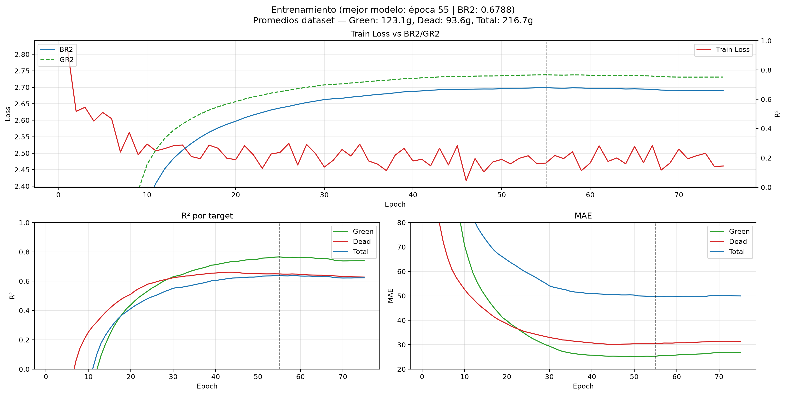

# GrassGauge

Estimación de biomasa de pasto seco —fracciones verde y muerta, en g/m²— a partir de una única fotografía cenital de pastura mediante un modelo de visión por computador basado en DINOv3 con adaptación eficiente de parámetros.

[](https://www.python.org/)
[](https://pytorch.org/)

## 2. Descripción

La cuantificación de la biomasa de pastura mediante muestreo de campo es laboriosa, destructiva y difícil de escalar. Este repositorio aborda dicho problema mediante regresión directa sobre imágenes RGB tomadas desde arriba, con el fin de predecir la materia verde seca y la materia muerta seca por metro cuadrado, así como su suma.

El conjunto de datos local contiene 72 imágenes etiquetadas con mediciones de laboratorio de ambos componentes, registradas en `data/raw/train_wide.csv` y almacenadas en `data/train/`. Se dispone además de 8 imágenes etiquetadas independientes, registradas en `data/test/test_wide.csv` y almacenadas en `data/test/`, que se mantuvieron separadas del conjunto anterior para la verificación del modelo. La validación se organiza sobre las 72 imágenes de entrenamiento en tres particiones estratificadas por intervalos de igual anchura sobre las dos variables objetivo, con semilla fija 16999. El modelo emplea el backbone `facebook/dinov3-vitl16-pretrain-lvd1689m`, adaptado con LoRA/DoRA sobre las proyecciones `q`, `k`, `v` y `o` (rango 32, alfa 64, dropout 0,01). Sobre los tokens de salida se aplican dos bloques `LocalMambaBlock`, un promedio global y dos cabezas de regresión con activación positiva. La optimización utiliza pérdida de Tweedie con p = 1,2 y pesos 0,4 y 0,6; normalización de etiquetas según el máximo del conjunto de entrenamiento de cada fold multiplicado por 1,1; precisión mixta; media móvil exponencial del modelo; calentamiento inicial; reducción de la tasa de aprendizaje por meseta y parada temprana.

La selección del checkpoint se realiza con BR2, definido como la media de los R² por objetivo menos 0,1 veces su desviación típica; GR2 corresponde al R² global ponderado. El aporte del código consiste en integrar en un flujo reproducible la construcción de folds, el entrenamiento validado, la inferencia con test-time augmentation de cuatro volteos y el promedio de los pesos `best_ema.pt` de todos los folds, además del registro de métricas por intervalo de peso.

## 3. Publicación

No se dispone de publicación asociada a este repositorio. En consecuencia, no se incluyen cita, DOI ni enlaces oficiales.

## 4. Stack / herramientas

- Python
- PyTorch
- Hugging Face Transformers (`facebook/dinov3-vitl16-pretrain-lvd1689m`)
- PEFT (LoRA/DoRA)
- timm (`ModelEmaV2`)
- Albumentations y OpenCV
- pandas y NumPy
- tqdm
- Matplotlib para la visualización de las curvas de entrenamiento

## 5. Qué hace el código

Todos los comandos se ejecutan desde la raíz del repositorio; los módulos se importan de forma plana, no como paquete.

- `python download_weights.py [HF_TOKEN]` descarga el backbone desde Hugging Face y lo almacena en `backbone_weights/`. Si ya existe `backbone_weights/config.json`, el modelo se carga desde esa ruta local.
- `python create_folds.py --input data/raw/train_wide.csv --output_dir ./data/folds/folds_v1 --n_splits 3` genera los archivos `fold_*.csv` con columnas `id`, `Dry_Green_g`, `Dry_Dead_g` y `split`. El valor por defecto de `--n_splits` es 5; las particiones incluidas en el repositorio y los resultados reportados corresponden a 3 folds. También acepta `--n_bins` y `--seed`.
- `python train.py --version v1 --epochs 100 --batch_size 2 --img_size 1024` entrena todos los folds. Las opciones adicionales son `--folds_dir`, `--only_fold`, `--seed` y `--deterministic`. Los resultados se escriben en `checkpoints/<version>/fold_<id>/` (`best_ema.pt`, `final_ema.pt`, `last_checkpoint.pth`) y en `logs/<version>/fold_<id>/` (`training.log`, `metrics.csv`).
- `python predict.py --csv data/test/test_wide.csv --images_dir data/test --weights_dir checkpoints/v1 --output predictions.csv` genera predicciones promediando los cuatro volteos y todos los pesos `best_ema.pt` encontrados. El CSV de entrada debe contener una columna `id`. Las opciones adicionales son `--batch_size`, `--img_size` y `--token`. La salida contiene `id`, `Dry_Green_g`, `Dry_Dead_g` y `Dry_Total_g`.
- `python scripts/plot_metrics.py --version v1 --fold 0 [--no-block]` muestra las curvas del fold indicado. La opción `--no-block` evita que la ejecución quede detenida al mostrar las figuras.

## 6. Resultados

La figura siguiente presenta las curvas del fold 0. El panel superior muestra la pérdida de entrenamiento y las métricas BR2/GR2 por época; los paneles inferiores muestran, respectivamente, el R² y el MAE por objetivo. La línea vertical discontinua señala la época con el BR2 máximo.



Los valores corresponden a la última ejecución registrada en `logs/v1/fold_*/metrics.csv`, que es la utilizada para la visualización.

| Fold | Mejor época | BR2 | GR2 | MAE Total (g/m²) |
| --- | ---: | ---: | ---: | ---: |
| 0 | 55 | 0,6788 | 0,7671 | 49,63 |
| 1 | 100 | 0,7290 | 0,8654 | 33,16 |
| 2 | 86 | 0,6322 | 0,7028 | 56,07 |
| Media ± desviación | — | 0,6800 ± 0,0484 | — | — |

Los promedios del conjunto de datos empleados en el título de la figura son 123,1 g para Green, 93,6 g para Dead y 216,7 g para Total.

## 7. Instalación y uso

Se requiere Python con `pip`. El entrenamiento y la inferencia funcionan en CPU, aunque el uso de GPU CUDA permite activar precisión mixta. Para cargar el backbone desde Hugging Face es necesario aceptar la licencia del modelo y definir `HF_TOKEN`; este paso no es necesario si `backbone_weights/` ya contiene el modelo.

```bash
pip install -r requirements.txt
python download_weights.py
```

Como alternativa de instalación, sin versiones fijas, se encuentra disponible `python install_deps.py`.

Flujo mínimo de reproducción:

```bash
python create_folds.py --input data/raw/train_wide.csv --output_dir ./data/folds/folds_v1 --n_splits 3
python train.py --version v1 --epochs 100 --batch_size 2 --img_size 1024
python predict.py --csv data/test/test_wide.csv --images_dir data/test --weights_dir checkpoints/v1 --output predictions.csv
python scripts/plot_metrics.py --version v1 --fold 0
```

## 8. Estructura del proyecto

```text
.
├── AGENTS.md
├── README.md
├── checkpoint.py
├── config.py
├── create_folds.py
├── dataset.py
├── download_weights.py
├── inference_dataset.py
├── install_deps.py
├── loss.py
├── metrics.py
├── model.py
├── predict.py
├── requirements.txt
├── train.py
├── trainer.py
├── transforms.py
├── backbone_weights/
│   ├── config.json
│   └── model.safetensors
├── checkpoints/v1/
│   └── fold_{0,1,2}/
├── data/
│   ├── raw/train_wide.csv
│   ├── folds/folds_v1/fold_{0,1,2}.csv
│   ├── train/
│   └── test/
├── docs/figures/
│   └── curvas_entrenamiento_fold_0.png
├── logs/v1/
│   └── fold_{0,1,2}/
├── scripts/
│   └── plot_metrics.py
└── utils/
    ├── log_setup.py
    ├── paths.py
    └── plotting.py
```

## 9. Autor y contacto

Autor: Daniel Polo Alcoba.  
Correo: dpoloalcoba@gmail.com.
