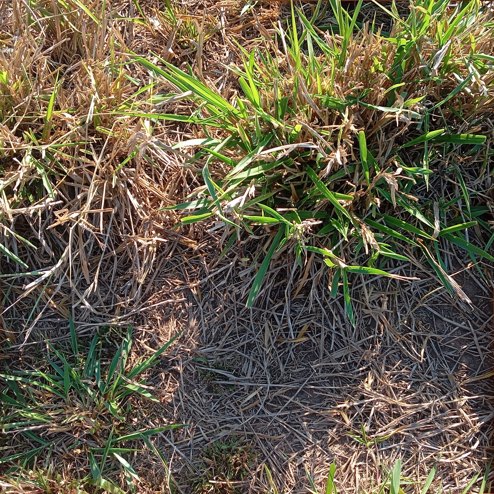
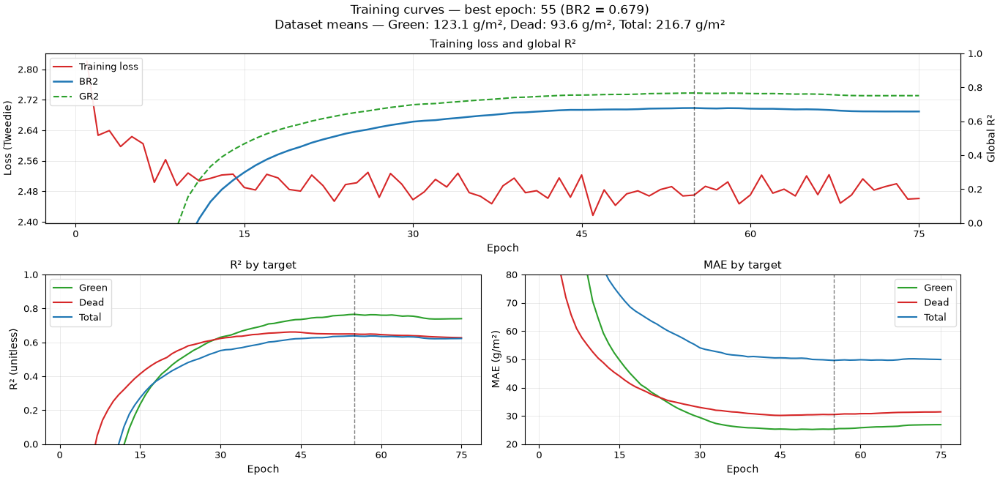

# ForageGauge

> Este repositorio contiene la versión open-source anterior del proyecto. Las métricas reportadas corresponden a una ejecución interna (v1, 15/11/2026) con datos y pesos no distribuidos públicamente, por lo que los comandos de aquí no las reproducen exactamente.

## 1. Problema y motivación

Medir la biomasa de pastura con muestreo de campo es laborioso, destructivo y difícil de escalar. Estimarla directamente a partir de una foto cenital permitiría monitorizar potreros con mucho menos trabajo de campo.

El objetivo es predecir materia verde seca, materia muerta seca y su suma, en g/m². Se dispone de 80 imágenes etiquetadas: 72 para entrenamiento y 8 de test independientes, separadas para la verificación.

## 2. Metodología y arquitectura

### 2.1 Flujo de trabajo

Las 72 imágenes de entrenamiento se dividen en 3 folds estratificados por ambos objetivos. Cada fold se entrena por separado y el checkpoint se selecciona con BR2, definido como la media de los R² por objetivo menos 0,1 veces su desviación típica. Para inferir, se promedian los pesos de los tres folds.

### 2.2 Modelo

Backbone DINOv3 ViT-L/16 congelado, adaptado con LoRA/DoRA (r = 32, alfa = 64) en las proyecciones `q`, `k`, `v` y `o`: 314,8 M parámetros totales y 11,65 M entrenables (3,7 %).

### 2.3 Entrenamiento

Imágenes redimensionadas a 1024×1024, con volteos, rotaciones y color jitter durante el entrenamiento; normalización ImageNet. Pérdida Tweedie (p = 1,2, pesos 0,4 para verde y 0,6 para muerta), AdamW, precisión mixta fp16, media móvil exponencial de los pesos y parada temprana.

## 3. Resultados principales

Métricas calculadas sobre imágenes de validación no vistas durante el entrenamiento:

| Fold | BR2 | GR2 | MAE total (g/m²) |
| --- | ---: | ---: | ---: |
| 0 | 0,679 | 0,767 | 49,6 |
| 1 | 0,729 | 0,865 | 33,2 |
| 2 | 0,632 | 0,703 | 56,1 |
| Media ± DE | 0,680 ± 0,048 | 0,778 ± 0,082 | 46,3 ± 11,8 |

El MAE total de 46,3 g/m² supone aproximadamente el 21 % de la biomasa media (216,7 g/m²). Con solo 80 imágenes los resultados son provisionales: la materia muerta es el objetivo más variable y el error crece con la biomasa.

## 4. Código y uso

El código de la ejecución v1 descrita arriba es privado y no se distribuye.
Este repositorio contiene la versión open-source anterior; su instalación y uso
se documentan en `GUIDE.md` y `README_SETUP.md`. Los datos, pesos y logs no se
incluyen en este repositorio.

Daniel Polo Alcoba — dpoloalcoba@gmail.com
